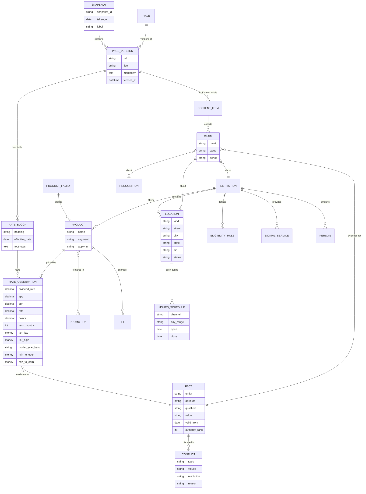

# Data model of the Dupaco snapshots

Derived from the five snapshots in `snapshots_zip/` (637 / 634 / 635 / 683 / 705 pages). Counts below are from the latest snapshot (05, 2026-09-28) unless stated.

## 1. What the corpus is made of

| Content type | Pages | What it carries |
|---|---:|---|
| Blog (`/learn/blog`) | 254 | Advice articles; the "About Dupaco" boilerplate paragraph (members, assets, employees, branch count) |
| Newsroom (`/newsroom`) | 167 | Dated press releases: branch openings and closures, awards, board results, dividends |
| Business resources | 116 | Small-business articles |
| Calculators | 33 | Tool pages with default inputs; some embed a copy of the rate tables |
| Product and rate pages | 37 | `/rates`, `/business-rates`, `/personal/...`, `/business/...`, `/checking`, `/contact` |
| Files (`/hubfs`) | 28 | 21 PDF, 7 spreadsheets: fee schedule, impact report, card terms, loan applications |
| Other (landing pages, about, careers, legal) | 70 | Promo landing pages (`*-lp`, `/earn-more`, `/switch-and-earn`), join/eligibility, privacy |

Rate-like table rows appear on 47 pages. `/rates` alone has 127 rows and `/business-rates` has 36. The same row is repeated on many pages (rate widgets, calculators, landing pages).

## 2. Entities and their data elements

### Crawl layer (how we know what we know)
| Entity | Attributes | Notes |
|---|---|---|
| **Snapshot** | snapshot_id, taken_on, label, description, page_count | 5 rows |
| **Page** | url (identity across snapshots), section/type | ~700 distinct URLs |
| **PageVersion** | snapshot_id, url, title, markdown, fetched_at | `fetched_at` can be older than the snapshot date: 681 of 705 pages in snapshot 05 were fetched on 09-28, the rest on 06-09, 06-11, 06-15, 08-27, 09-03, 09-27 |

### Product and pricing layer
| Entity | Attributes |
|---|---|
| **ProductFamily** | Share Savings, Bright Savings, You Name It, Holiday Club, Launchpad, Money Market, High-Yield Savings, Certificates, IRAs (Roth/Traditional, regular/special/variable), HSA, Free Checking, 1st Rate Checking, Auto & Motorcycle, Credit Cards, Home Loans (purchase/refinance), Home Equity (HELOC/fixed), Home Improvement, Personal Loan, Boat & RV, ATV/Snowmobile/Jet Ski, Student, Business equivalents |
| **Product** | name, segment (personal / business), family, min_to_open, min_to_earn, apply_url, details_url |
| **RateBlock** | the heading and table on a page, `effective_date`, footnote/disclosure text, parent PageVersion |
| **RateObservation** (one table row) | product, dividend_rate, apy, apr, rate, points, payment_example, plus the qualifiers below |
| **Promotion** | name (e.g. 17-Month Special, intro balance-transfer 2.90%, switch-and-earn cash back), terms, start/end, landing URL |
| **Fee** | name (overdraft $30, temporary draft $5, cash advance $10 or 3%, foreign transaction 1%, late fee $15, returned payment $25, business sweep $10/month), amount, source (fee-schedule PDF or product page) |

Qualifiers that make two numbers different facts rather than a conflict:
- **Term:** months (10, 17, 24 to 120).
- **Balance tier:** $0 to $99.99, $100 to $2,499.99, up to $1,000,000.
- **Loan-amount tier:** mortgage $100k / $200k / $300k / $832,750; boat/RV $10k, $25k, $40k.
- **Model-year band:** 2024-27, 2017-20, 2016 and older.
- **Other:** segment (personal vs business), jumbo vs standard, rate vs APY vs APR, fixed vs variable, intro vs standard, purchase vs refinance, "as low as".

### Organization and location layer
| Entity | Attributes |
|---|---|
| **Institution** | name, mailing address (P.O. Box 179, Dubuque IA 52004-0179), phone 800-373-7600, routing number 273974581, mortgage team phone, NCUA insurance limit, CDFI status, charter area (counties in IA, IL, WI) |
| **Location** | kind (branch, learning lab, surcharge-free ATM, live video teller), name, street, city, state, zip, phone, services (drive-up, live video teller, 24-hour ATM), status (open, closed, closing date) |
| **HoursSchedule** | location (or "typical"), channel (lobby, drive-up, phone support), day range, open, close |
| **Person** | name, role, region, NMLS number (mortgage consultants), executives, board members |
| **EligibilityRule** | live/work in charter area, family member of a member, belongs to a qualifying organization |
| **DigitalService** | Shine online/mobile banking, mobile wallets (Apple, Google, Samsung Pay), BrightTrack credit monitoring, join link, rates link |

### Narrative layer (dated claims, mostly stale)
| Entity | Attributes |
|---|---|
| **ContentItem** | kind (press release, blog, resource), title, publish_date, tags |
| **Claim** | metric (branch count, members, assets, employees, volunteer hours, awards), value, period or as-of, source ContentItem |
| **Recognition** | awarder (e.g. Forbes Best-in-State), ordinal ("fifth time"), year |
| **Link** | target URL, anchor text, role (join, rates, locator), canonical vs legacy host |

### Derived layer (what the solution should compute)
| Entity | Attributes |
|---|---|
| **Fact** | key = (entity, attribute, qualifiers), value, valid_from, valid_to, authority_rank, evidence[] |
| **Conflict** | topic, competing values, sources, resolution, reason |

## 3. ER diagram

## 4. Time has five meanings here

| Clock | Where it lives | Use it for |
|---|---|---|
| Snapshot date | manifest `taken_on` | "as of" questions, choosing which snapshot to read |
| Page `fetched_at` | manifest, per page | Real freshness of a page; can lag the snapshot date |
| Block effective date | "Rates are effective as of MM/DD/YYYY" under each table | Real freshness of a rate. `/rates` has 10 different effective dates (01/02/2026 to 09/25/2026) on one page |
| Publication date | press release / blog header | Age of a narrative claim |
| Event or period date | in the text ("will close March 31, 2026", "in 2023") | Temporal questions about events |

## 5. Where a fact lives (authority tiers)

1. **Canonical:** `/rates`, `/business-rates`, product pages, `/contact` (address, phone, routing number, locator), fee-schedule PDF.
2. **Derived copies:** calculators and promo or landing pages (`/switch-and-earn`, `/earn-more`, `/membermoneymarket-lp`, `/checking-offer-lp`, `/newcard-balancetransfer-lp`). These embed rate tables that may lag.
3. **Narrative:** press releases and blogs. Right for events, awards and counts as of their date, wrong as "current" values.

## 6. Observed data-quality patterns (these generate the conflicts)

- **Stale embedded rates.** 60-month auto: `/rates` and the product page say 5.39% (2024-27 band). `/calculators/vehicle-affordability` and `/switch-and-earn` say 5.34% under a "2023-26 Model Year" label. The old label is a tell. The same pattern holds at other terms (6.29% vs 6.34%, 8.54% vs 8.59%).
- **Promo pages disagreeing:** Achieve Money Market is advertised as a 4.00% introductory dividend rate / 3.66% APY on `/earn-more` (fetched 09-28) but as 3.20% rate / 3.25% APY on `/membermoneymarket-lp` (last fetched 06-15). One may be a newer or different offer; a system has to decide between "superseded" and "intro vs standard".
- **Stale mortgage copies:** `/homebuying-guidance` and `/mortgage-refi` still show 3-decimal rates (5.500%, 5.954%, 6.037%) in snapshot 05, while `/rates` shows 7.13% / 7.25% effective 09/25/2026.
- **Count drift:** branches are 18 on `/about`, 22 in the press-release boilerplate, 23 and 24 in older boilerplate. The `/contact` locator says "33 Results", which counts ATMs and video tellers too.
- **Format drift between snapshots:** bold effective-date lines in early snapshots, `$100,000` vs `$100,000.00`, 3-decimal vs 2-decimal rates, stray `\\r\\n` text in footnotes.
- **Page-level change is mostly noise.** About 615 of 637 pages differ between snapshots 01 and 02, mainly from captcha text, a Messenger widget and ATM counts. Compare facts, not pages.
- **Locator widget** shows "Closed" for every branch (captured outside hours), so it carries no usable hours. Hours come from branch-opening press releases.
