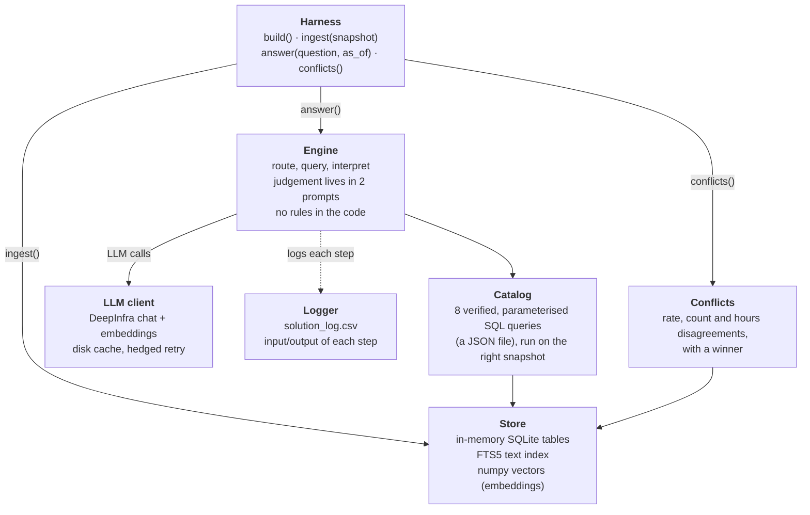
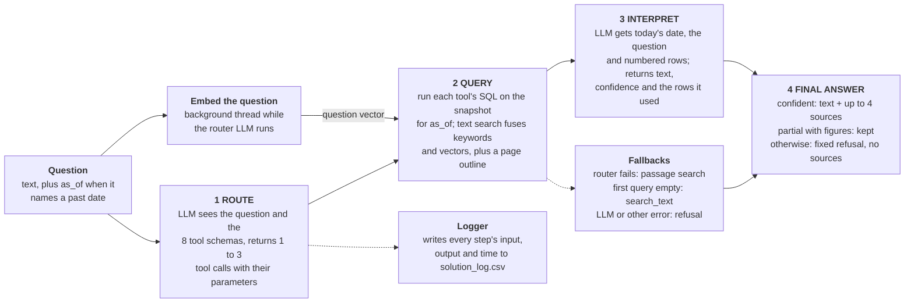
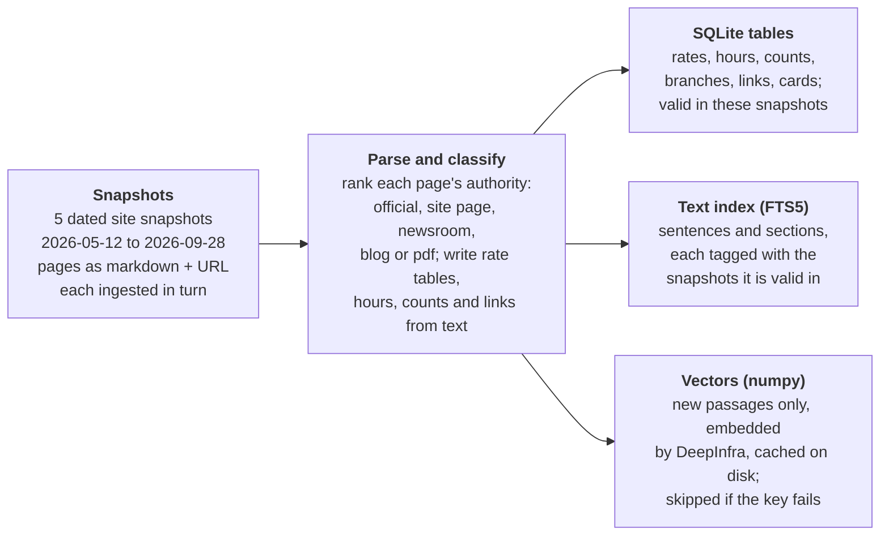

# Dupaco knowledge system: notes

The LLM picks a verified SQL query, the query runs on an in-memory SQLite database built from all snapshots, and the LLM
writes the answer from the returned rows and names the rows it used (those rows' URLs become the sources).

## Setup

**Requirements:** Python 3.9 or newer (tested on 3.11) with SQLite FTS5, and one package, `numpy`. Network access to
`api.deepinfra.com` is needed for the LLM and embeddings.

```bash
# from the top folder of the kit
pip install -r submission/requirements.txt
export DEEPINFRA_API_KEY=...        # the only key needed (chat model and embeddings)
python harness/run_eval.py --submission submission --eval eval/public_eval.jsonl
```

- **Ingest** builds the database and embeds the passages. Embeddings are cached in `.emb_cache.pkl`, so later runs skip them. Ingest stops embedding after 15 minutes (`EMBED_BUDGET_S`), far under the 30 minute limit.
- **Without `DEEPINFRA_API_KEY`** (or if the API is down) nothing crashes: the system answers from plain keyword passage
  search, and low-confidence answers become a fixed refusal. Accuracy is much lower.
- **Cache:** LLM replies are cached in `.llm_cache.json`. Delete it before a timing run, or timings will be too good.
- **Log:** every step of every question (input, output, milliseconds) is appended to `solution_log.csv`.
  Ask one question and print its answer and sources with `python tools/ask.py "<question>"`.

**Optional settings** (environment variables): `DEEPINFRA_MODEL` (default `deepseek-ai/DeepSeek-V4-Flash-0731`),
`DEEPINFRA_BASE_URL`, `EMBED_MODEL` (default `BAAI/bge-base-en-v1.5`; `off` disables vectors), `LLM_MAX_CALLS`,
`LLM_RETRIES`, `LLM_HEDGE_S`, `LLM_CACHE`, `EMBED_CACHE`, `DUPACO_LOG=0` (turn the log off), `DUPACO_LOG_FILE`.

**Files** (all under `submission/`):

| File | Role |
|---|---|
| `solution.py` | Entry point: `build()` returns `ingest`, `answer`, `conflicts` |
| `kb/engine.py` | The pipeline (route, query, interpret) and the two prompts |
| `kb/catalog.py`, `kb/verified_queries.json` | The eight verified queries (the only SQL that runs) |
| `kb/store.py`, `kb/parse.py` | Ingest: parse pages into SQLite tables and passages |
| `kb/vec.py` | Embeddings and vector search |
| `kb/llm.py` | DeepInfra client: disk cache, retries, hedged request |
| `kb/conflicts.py` | The `conflicts()` report |
| `kb/logger.py` | Step log |

**Scores:** `docs/SCORE_LOG.md` has every iteration. The latest run on the 40 public questions scored 0.969 accuracy.
The one miss is dup-005, whose gold answer has nothing checkable (no `must_include`). `docs/ARCHITECTURE.md` and
`docs/DATA_MODEL.md` are short versions of the sections below.

---

# Design: Dupaco Knowledge Hackathon

## Design choices

### 1. Preprocess snapshots into SQLite tables

Most questions are lookups, and structured tables give exact answers. Storing each page's authority tier, effective date
and snapshot validity lets SQL pick the right value, so the LLM never has to referee stale copies.

### 2. Rank sources by authority

Canonical product and contact pages rank first, then landing and promo pages, then newsroom and calculators, and last
blog posts and PDFs. When copies disagree, the higher-ranked page wins.

### 3. Embeddings for semantic search in addition to text search

Keyword search is exact but brittle. Fusing SQLite's FTS5 with numpy vector search (embeddings from DeepInfra's service)
by reciprocal rank handles reworded questions with no vector database, and falls back to keywords if embeddings fail.

### 4. Give tools (verified queries) to the LLM to route/pick relevant queries

The LLM picks a query and fills in its parameters, while the SQL stays fixed and auditable. Answers come from tables and
are consistent across runs.

### 5. Two LLM calls: route, then interpret

Two small, focused prompts: one picks the relevant tools (queries), and the other interprets the query results.

### 6. Reliability

The system uses a disk cache, a lock around SQLite, and a refusal on any exception, so it never crashes. Every step is
logged, so failures can be traced.

## Architecture

### Component diagram



### Control flow



The router picks queries, SQL returns the rows, and the second LLM call produces the answer and names its sources.

### Ingestion flow



## Data model

- **snaps** (`idx`, `snap_id`, `taken_on`): one row per snapshot. All other tables point to it through `snap_idx`.
- **pages** (`snap_idx`, `url`, `title`, `rank`, `pub`, `fetched_at`): one row per page per snapshot. `rank` is the authority tier, and `url` links a page to its facts.
- **rates** (`snap_idx`, `url`, `family`, `segment`, `label`, `lo`, `hi`, `rate`, `apr`, `apy`, `eff`): one row per rate tier on a page. `lo` and `hi` are the balance or amount band, and `eff` is the effective date.
- **cards** (`snap_idx`, `url`, `name`, `lo`, `hi`, `intro`, `intro_text`): one row per credit card, with its APR range and introductory rate.
- **hours** (`snap_idx`, `url`, `kind`, `lines`, `pub`): one row per schedule found in a press release, where `kind` is lobby or drive-up.
- **locator** (`snap_idx`, `url`, `name`, `kind`, `street`, `city`, `state`, `zip`, `services`): one row per branch or ATM.
- **counts** (`snap_idx`, `url`, `pub`, `value`): one row per branch count stated in a press-release footer.
- **links** (`snap_idx`, `url`, `text`, `href`): one row per link, for "where do I find X" questions.
- **sent** (`id`, `url`, `rank`, `pub`, `head`, `text`, `first_idx`, `last_idx`): one row per passage. It is valid from snapshot `first_idx` to `last_idx`, so an unchanged passage is stored once.
- **sent_fts**: the FTS5 full-text index on each passage's text, one entry per `sent` row. Each passage also has one embedding vector, held in memory outside the database.
